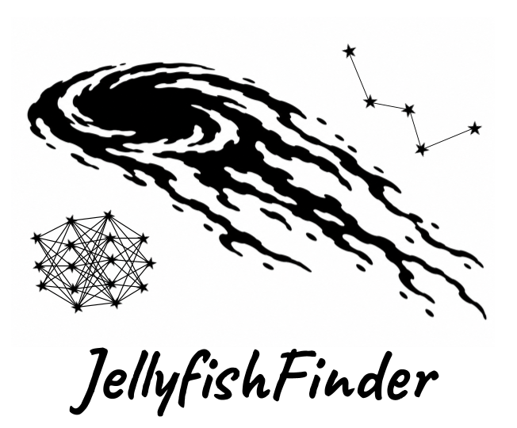

# Jellyfish Finder
<p align="center">
  
</p>

**Version:** V1

**Jellyfish Finder** is an end-to-end Python script that uses a Vision Transformer model to automatically search through desired galaxy cluster images from HST and JWST (with possibilities of Roman and Euclid) for new candidates of galaxies undergoing ram-pressure striping (RPS). The current version only allows the model to perform inferences using **CPU**, but later use of CUDA may be implemented.

## Installation
1. **Clone this repository:**
   ```bash
   git clone https://github.com/cjwinkler23/Jellyfish_Finder
   cd Jellyfish_Finder
   ```

2. **Create and activate the Conda environment:**
   ```bash
   conda env create -f env.yml
   conda activate jellyfish_env
   ```

## Weights

### Downloading the weights:
Download the weights file 'JellyfishFinder-1.pth' using the Hugging Face [Download Link](https://huggingface.co/cwink23/JellyfishFinder/resolve/main/JellyfishFinder-1.pth) and place the file inside the 'weights/' directory located in the main project folder.

The current model has resulted from:
- **Backbone Architecture:** Meta's [DINOv2 ViT-S/14](https://github.com/facebookresearch/dinov2 "facebookresearch/dinov2") weights.
- **Training Framework:** Fine-tuning was done using the script provided by [AstroVink](https://github.com/SaamieVincken/AstroVink).
- **Fine-Tuning:** All transformer layers and the final classification head were left unfrozen and fine-tuned on a sample of ~50 (V1) RPS galaxies.

## Repository Structure

```
Jellyfish_Finder/
├── local_fits/                Recommended location for FITS images of clusters to be stored in 'local' mode
├── output_candidates/         Final output location of jellyfish candidate cutouts
├── temp_downloads/            Temporary storage location to download cluster images from MAST
├── weights/                   Folder to contain the .pth weights file
├── config.ini                 Configuration file used to specify mode and user parameters
├── run_jellyfish_finder.py    Main Python script
└── env.yml                    Environment file containing all required packages

```

## Modes
The run_jellyfish_finder.py script can be run in one of three modes depending on the user's needs and preferences. The selected mode changes how the script is fed the desired cluster images:

1. **obs_id:**
   - **Allows you to input a list of observation IDs and get out the jellyfish galaxy candidates from those observations.**
   - Requires the most preliminary work, but offers the most control over the final cluster image.
   - Requires a CSV file with column headers - cluster_name, obs_id - where each row represents one MAST resolvable HST or JWST observation of a particular cluster.
   - cluster_name is only used as a designating term that's put at the beginning of each cutout's file name that came from the corresponding observation, not for the MAST search.
   - obs_id is used to query the MAST database and download the fits file associated with that particular observation.
  
2. **name_coords:**
   - **Allows you to only give a list of cluster names and/or a list of coordinates to search through and automatically output all the candidates from the available unique pointings found in that cluster.**
   - Requires the least preliminary work- only a list of desired cluster names and/or coordinates is needed.
   - Requires a CSV file with column headers - cluster_name, RA, DEC, radius (arcmin) - where each row contains at least the cluster name or an RA, DEC coordinate.
   - cluster_name will be used to name the output candidate files and as the primary MAST search term if no RA and DEC are given for that line.
   - radius tells MAST the search radius in arcmin to use for each row. If none is given, MAST will default to the value set in the [DEFAULT] section of the *config.ini* file.
   - Other MAST parameters can be set within the *config.ini* file.


3. **local:**
   - **Allows you to apply the script on any local HST/JWST fits files stored in a specified folder - 'local_fits' is the default.**
   - Requires you to specify the data directory path in the *config.ini* file
   - The folder may contain other files, but only files with the extensions (.fits, .fit, .fits.gz) will be recognized by the script. If no fits files exist in the specified folder, an error will be given.
   - Jellyfish galaxy candidates found within those images will be saved to the output_candidates/ folder

## Usage
1. **Begin by setting up the *config.ini* file:**
   - Open *config.ini* either using CLI or a text editor.
   - Values under \[DEFAULT\] should only be changed if a different default value is preferred. These will be used as a fallback if a required value is missing or commented out.
   - Type the preferred mode next to 'mode = '. Descriptions are given above.
   - Under \[MODEL\], 'weights_file' is required. Specify the path to the .pth file to be used for inference. If the weights are put in 'weights/' as recommended, path can be given as 'model.pth' or 'weights/model.path'. Instructions for downloading the weights are given below.
   - For the rest of the *config.ini* file, only the parameters under the chosen mode's section are required to have a value. Parameters that have a listed default value can be left blank or commented out if the default value is wanted.
   - Parameters that require a path to be given can be absolute from the drive or relative from the project directory. Ex: If csv_file.csv is at 'Jellyfish_Finder/tables/csv_file.csv', the path given should be absolute from the drive or realtive (./tables/csv_file.csv or simply tables/csv_file.csv).
  
2. **Run the Jellyfish_Finder Python Script:**
   - Within anaconda prompt, ensure the jellyfish_env environment is active and the current working directory is Jellyfish_Finder. If not already, run:
     ```bash  
     conda activate jellyfish_env
     cd path/to/Jellyfish_Finder    #Replace with real path to project directory.
     ```
   - To run the script with configuration file named *config.ini* located at 'Jellyfish_Finder/config.ini', no flag is required and it can be run by:
     ```bash  
     python run_jellyfish_finder.py
     ```
   - If the configuration file has a custom name or was put in a new location, using the configuration designation, run:
     ```bash  
     python run_jellyfish_finder.py config_path/my_custom_config.ini    #Replacing with the file's name and path
     ```

3. **Output Jellyfish Galaxy Candidates:**
   - All galaxy cutouts that received an inference score above the 'percent_conf' value will be stored in 'output_candidates/'.
   - Files will be named according to the mdoe that was used:
     - **obs_id**:
       - percent score, host cluster name, observation id, RA, DEC
       - Ex: Score-87.22%__MACSJ0553-3342__jw06882-o023_t023_nircam_clear-f150w__RA-88.323-DEC--33.711.jpg
     - **name_coords**:
       - percent score, cluster name (if given), file name (found from MAST), RA, DEC
       - Ex: Score-63.49%__MACSJ0553-3342__jw06882-o023_t023_nircam_clear-f150w__RA-88.292-DEC--33.707.jpg
     - **local**:
       - percent score, fits file name it came from, RA, DEC
       - Ex: Score-95.87%__A3627_f444w__RA-36.29-DEC-108.71.jpg

4. **Visual Check to Determine True Candidates:**
   - Once the script finishes and all cutouts are in 'output_candidates/', the user can visually determine whether or not each cutout is actually a potential jellyfish galaxy.
   - **Note:** The higher the minimum percent_conf parameter is set, the fewer candidates will be output. To ensure potential jellyfish galaxies aren't excluded, one can lower the percent_conf and do a longer manual identification later.


## Acknowledgements

This project utilizes the DINOv2 architecture developed by Meta AI. 

```bibtex
@misc{oquab2023dinov2,
  title={DINOv2: Learning Robust Visual Features without Supervision},
  author={Oquab, Maxime and Darcet, Timothée and Moutakanni, Théo and Vo, Huy and Szafraniec, Marc and Khalidov, Vasil and Labatut, Patrick and Joulin, Armand and Bojanowski, Piotr},
  journal={arXiv preprint arXiv:2304.07193},
  year={2023}
}
```

This project utilizes the AstroVink pipeline developed by Saamie Vincken to fine-tune the vision transformer model.

```bibtex
@software{vincken2024astrovink,
  author       = {Vincken, Saamie},
  title        = {AstroVink: Visual Transformers for Astronomical Source Classification},
  year         = {2024},
  publisher    = {GitHub},
  journal      = {GitHub Repository},
  howpublished = {\url{https://github.com}}
}
```
